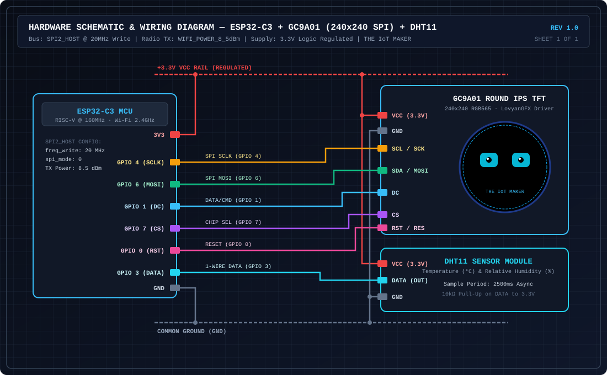

# ESP32-C3 + GC9A01 Smart Companion & IoT Environmental Dashboard

An embedded firmware project for the **ESP32-C3** microcontroller driving a **240×240 circular GC9A01 IPS SPI display** (via **LovyanGFX**) and a **DHT11 temperature & humidity sensor**. The system alternates every 4 seconds between an expressive **18-state Robotic Companion Face** and a real-time **NTP-synchronized Smart Environmental Dashboard**.

---

## Key Features

- **Dual-Mode Autonomous Scheduler (`4000ms` Cycle)**:
  - **Mode 1 — Robotic Companion (`MODE_FACE`)**: Renders 18 distinct procedural expressions (`NEUTRAL`, `HAPPY`, `SAD`, `ANGRY`, `SLEEPY`, `SURPRISED`, `CURIOUS`, `CONFUSED`, `EXCITED`, `SUSPICIOUS`, `SCARED`, `LOVE`, `DIZZY`, `THINKING`, `CRYING`, `PLAYFUL`, `TIRED`, `DETERMINED`) with randomized eye saccades (`gazeX`, `gazeY`) and natural blinking (`150ms` closure).
  - **Mode 2 — Smart Telemetry Dashboard (`MODE_DASHBOARD`)**: Displays live Wi-Fi connection status, NTP-synchronized local clock and date (`UTC+5:30` IST / configurable), and dual-card DHT11 Temperature (`°C`) & Relative Humidity (`%`) readouts with flicker-free partial region updates.
- **Zero-Framebuffer Direct TFT Rendering**: Draws primitives directly to the GC9A01 over `SPI2_HOST` without allocating a 115 KB RAM sprite buffer, leaving ample heap headroom for the ESP32-C3 Wi-Fi/TCP stack.
- **RF & SPI Coexistence Hardening**:
  - Caps SPI write clock to `20 MHz` (`cfg.freq_write = 20000000`) and lowers Wi-Fi radio transmit power to `8.5 dBm` (`WiFi.setTxPower(WIFI_POWER_8_5dBm)`) to eliminate antenna harmonic coupling and brownout resets on compact ESP32-C3 SuperMini boards.
- **240×240 RGB565 Boot Splash (`iot_maker_logo_240.h`)**: Displays a full-resolution circular emblem on boot before entering the main scheduler loop.

---

## Hardware Schematic & Connection Diagram



### Pinout Mapping Table

| ESP32-C3 Pin | Peripheral Target | Signal Name | Direction | Firmware Constant / Config | Electrical Notes |
| :--- | :--- | :--- | :--- | :--- | :--- |
| **GPIO 4** | GC9A01 Pin `SCL` / `SCK` | SPI Clock | Output | `cfg.pin_sclk = 4` | `20 MHz` SPI2 Master Clock |
| **GPIO 6** | GC9A01 Pin `SDA` / `MOSI` | SPI Data In | Output | `cfg.pin_mosi = 6` | SPI2 MOSI Data Line |
| **GPIO 1** | GC9A01 Pin `DC` | Data / Command | Output | `cfg.pin_dc = 1` | Register select control |
| **GPIO 7** | GC9A01 Pin `CS` | Chip Select | Output | `pc.pin_cs = 7` | Active-low SPI select |
| **GPIO 0** | GC9A01 Pin `RST` / `RES` | Hardware Reset | Output | `pc.pin_rst = 0` | Panel initialization reset |
| **GPIO 3** | DHT11 Pin `DATA` / `OUT` | 1-Wire Telemetry | Bi-dir | `#define DHT_PIN 3` | Use `10kΩ` pull-up to `3.3V` (built into 3-pin PCB modules) |
| **3.3V** | GC9A01 `VCC` + DHT11 `VCC` | Regulated Power | Supply | — | Do **not** feed 5V to GC9A01 logic pins |
| **GND** | GC9A01 `GND` + DHT11 `GND` | Common Ground | Return | — | Shared reference ground |

---

### ASCII Wiring Schematic

```text
                       +------------------------------+
                       |         ESP32-C3 MCU         |
                       |     (SuperMini / DevKitM)    |
                       +------------------------------+
                       |                              |
                       |                         3.3V +---------+------------------+
                       |                          GND +-----+---|--------------+   |
                       |                              |     |   |              |   |
                       |        SPI2_HOST (20MHz)     |     |   |              |   |
                       |               GPIO 4 (SCLK)  +-----|-- | --------+    |   |
                       |               GPIO 6 (MOSI)  +-----|-- | ------+ |    |   |
                       |               GPIO 1 (DC)    +-----|-- | ----+ | |    |   |
                       |               GPIO 7 (CS)    +-----|-- | --+ | | |    |   |
                       |               GPIO 0 (RST)   +-----|-- | + | | | |    |   |
                       |                              |     |   | | | | | |    |   |
                       |        1-WIRE SENSOR         |     |   | | | | | |    |   |
                       |               GPIO 3 (DATA)  +---+ |   | | | | | |    |   |
                       +------------------------------+   | |   | | | | | |    |   |
                                                          | |   | | | | | |    |   |
       +--------------------------------------------------+ |   | | | | | |    |   |
       |                                                    |   | | | | | |    |   |
       |    +---[ 10kΩ Pull-up ]---+                        |   | | | | | |    |   |
       |    |                      |                        |   | | | | | |    |   |
       v    v                      |                        |   | | | | | |    |   |
  +--------------+                 +------------------------|---|-|-|-|-|-|----+   |
  | DATA     VCC |<-----------------------------------------+   | | | | | |        |
  |              |                                              | | | | | |        |
  |    DHT11     |                 +----------------------------+ | | | | |        |
  |  Temp & Hum  |                 |   +--------------------------+ | | | |        |
  |              |                 |   |   +------------------------+ | | |        |
  |     GND      |                 |   |   |   +----------------------+ | |        |
  +------+-------+                 |   |   |   |   +--------------------+ |        |
         |                         |   |   |   |   |   +------------------+        |
         |                         v   v   v   v   v   v                           |
         |                     +---------------------------+                       |
         |                     |  VCC RST  CS  DC SDA SCL  |                       |
         |                     |                           |                       |
         |                     |      GC9A01 240x240       |                       |
         |                     |    Round IPS SPI Display  |                       |
         |                     |                           |                       |
         |                     |            GND            |                       |
         |                     +-------------+-------------+                       |
         |                                   |                                     |
         +-----------------------------------+-------------------------------------+
                                             |
                                            === GND
```

---

## Repository Structure

```text
├── README.md                                            # Project documentation & wiring guide
├── docs/
│   └── schematic.svg                                    # Vector schematic & connection diagram
└── firmware/
    ├── platformio.ini                                   # PlatformIO build & library configuration
    └── esp32c3_gc9a01_companion/
        ├── esp32c3_gc9a01_companion.ino                 # Main Arduino / ESP32-C3 application sketch
        └── iot_maker_logo_240.h                         # 240x240 RGB565 PROGMEM startup splash bitmap
```

---

## Robotic Expression Engine (18 States)

In `MODE_FACE`, the expression engine cycles every `3000ms` (`EMOTION_MS`) across 18 procedural states while executing independent blink (`BLINK_MS = 150ms`) and gaze saccade timers:

| Index | Enum Identifier | Eye Geometry (`w × h`) | Primary Color (`RGB565`) | Procedural Overlay / Extras |
| :---: | :--- | :---: | :---: | :--- |
| `0` | `NEUTRAL` | `64 × 54` | `CYAN (0x07FF)` | Standard pupils with specular highlight |
| `1` | `HAPPY` | `64 × 38` | `CYAN (0x07FF)` | Pink cheek blush lines |
| `2` | `SAD` | `64 × 49` | `BLUE (0x249F)` | Downward gaze (`gy = 4`), sloped upper eyelids |
| `3` | `ANGRY` | `64 × 43` | `BLUE (0x249F)` | Furrowed V-brows, sharp inner eyelid mask |
| `4` | `SLEEPY` | `64 × 32` | `BLUE (0x249F)` | Forced closed curved arc eyelids |
| `5` | `SURPRISED` | `58 × 62` | `CYAN (0x07FF)` | Raised horizontal eyebrows, widened eyes |
| `6` | `CURIOUS` | `60 × 50` | `CYAN (0x07FF)` | Side gaze offset (`gx = 7`), asymmetric brow |
| `7` | `CONFUSED` | `64 × 45` | `CYAN (0x07FF)` | Leftward gaze (`gx = -4`), tilted brows |
| `8` | `EXCITED` | `64 × 58` | `YELLOW (0xFFE0)` | White ringed pupils + dual yellow corner sparkles |
| `9` | `SUSPICIOUS` | `64 × 36` | `BLUE (0x249F)` | Narrowed squint + side glance (`gx = 8`) |
| `10` | `SCARED` | `58 × 60` | `BLUE (0x249F)` | Open circular mouth (`r = 8`) + high brows |
| `11` | `LOVE` | `64 × 52` | `PINK (0xF81F)` | Pink heart pupils + floating corner hearts |
| `12` | `DIZZY` | `64 × 52` | `PURPLE (0xA81F)` | Crossed `X` pupils + concentric mouth rings |
| `13` | `THINKING` | `64 × 48` | `CYAN (0x07FF)` | Upward-right gaze (`gx = 9, gy = -5`) + thought bubbles |
| `14` | `CRYING` | `64 × 44` | `BLUE (0x249F)` | Sloped sad brows + cyan teardrop triangles |
| `15` | `PLAYFUL` | `64 × 45` | `CYAN (0x07FF)` | Pink V-smile mouth + playful side gaze |
| `16` | `TIRED` | `64 × 32` | `BLUE (0x249F)` | Heavy top eyelid mask (`h / 3` occlusion) |
| `17` | `DETERMINED` | `64 × 42` | `BLUE (0x249F)` | Angled brows + focused upper eyelid cut |

---

## Flashing & Setup Instructions

### Option A: Arduino IDE

1. **Install ESP32 Board Support**:
   - Open **File → Preferences** and add `https://espressif.github.io/arduino-esp32/package_esp32_index.json` to *Additional Boards Manager URLs*.
   - Open **Tools → Board → Boards Manager**, search for **esp32** by Espressif Systems, and install version `2.0.14+` or `3.x`.
   - Select **ESP32C3 Dev Module** (enable **USB CDC On Boot: Enabled** if using an ESP32-C3 SuperMini over native USB).
2. **Install Required Libraries** (via **Sketch → Include Library → Manage Libraries**):
   - `LovyanGFX` by lovyan03 (`>= 1.1.16`)
   - `DHT sensor library` by Adafruit (`>= 1.4.6`)
   - `Adafruit Unified Sensor` by Adafruit (`>= 1.1.14`)
3. **Configure Wi-Fi & Timezone**:
   - Open `firmware/esp32c3_gc9a01_companion/esp32c3_gc9a01_companion.ino` and update:
     ```cpp
     const char* WIFI_SSID = "esp";
     const char* WIFI_PASSWORD = "YOUR_WIFI_PASSWORD";
     const char* LOCATION_NAME = "BENGALURU";
     const long GMT_OFFSET_SEC = 19800; // UTC+5:30
     ```
4. **Upload**:
   - Ensure `iot_maker_logo_240.h` is in the same folder as `esp32c3_gc9a01_companion.ino`, then click **Upload**.

### Option B: PlatformIO CLI / VS Code

```bash
cd firmware
pio run --target upload --target monitor
```

---

## License

Released under the Apache-2.0 / MIT Open-Source Hardware & Firmware License.
